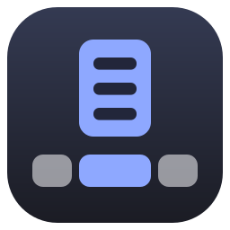
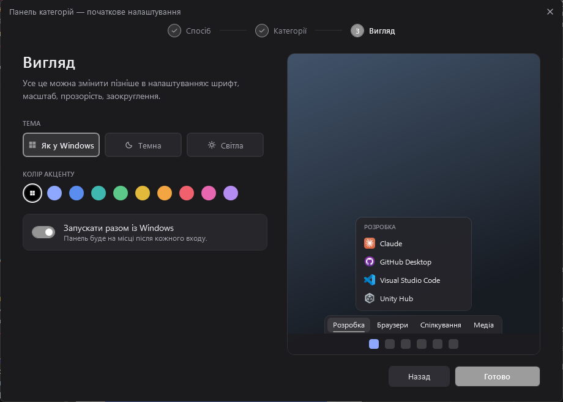
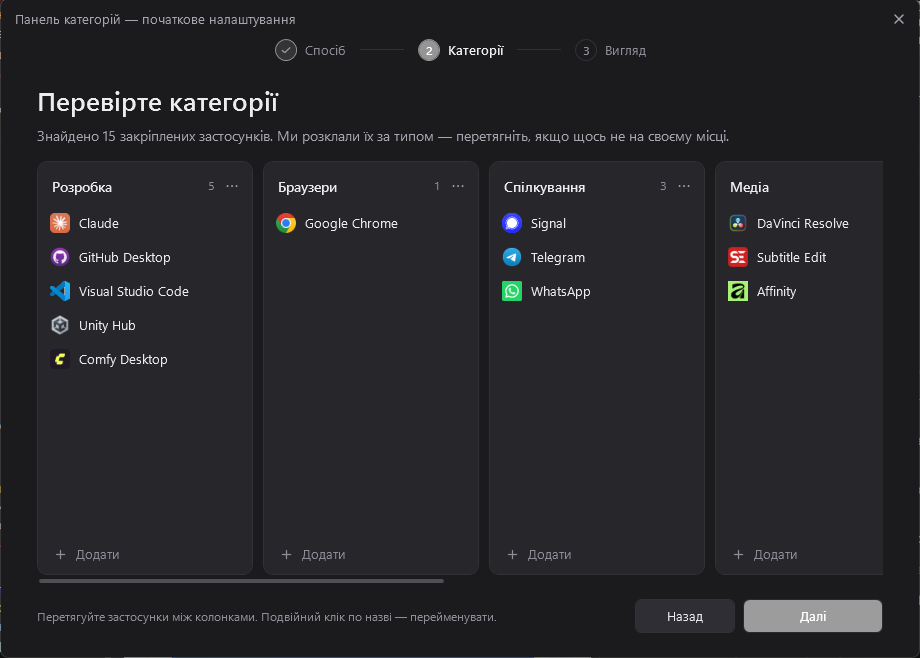
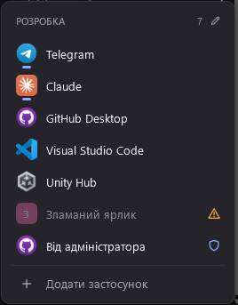
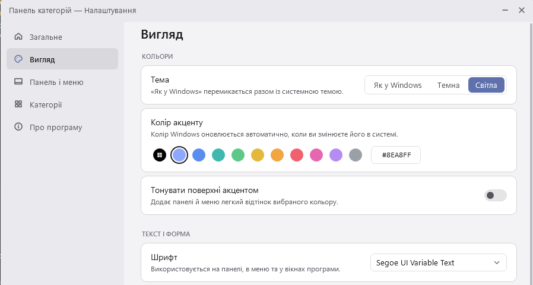
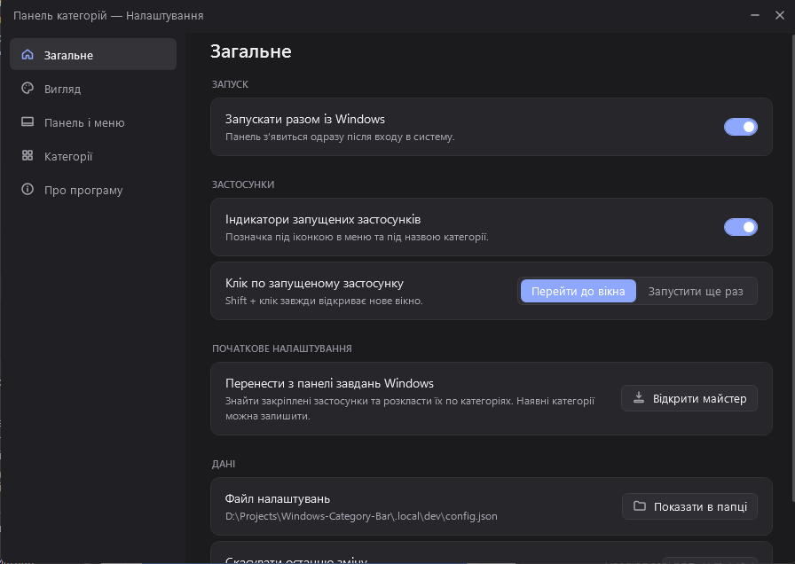

<div align="center">



# Панель категорій для Windows 11

**Вкладки категорій над панеллю завдань: наведіть курсор — і застосунки відкриються колонкою.**

[](https://github.com/Chikanut/Windows-Category-Bar/releases/latest)
[](https://github.com/Chikanut/Windows-Category-Bar/releases)


[Завантажити](https://github.com/Chikanut/Windows-Category-Bar/releases/latest) · [Можливості](#можливості) · [Збірка з коду](#збірка-з-коду)

[English](README.md) · **Українська**

</div>

---

Коли закріплених значків на панелі завдань стає забагато, потрібну програму важко знайти. Панель категорій розкладає ярлики по вкладках — «Розробка», «Браузери», «Ігри» — і ставить їх одразу над панеллю завдань Windows. Сама панель завдань працює як раніше.

<p align="center">
  
</p>

## Чому це зручно

- **Один рух замість пошуку.** Наведіть курсор на вкладку, і її застосунки з’являться колонкою. Клік запускає програму.
- **Готово за хвилину.** Майстер переносить закріплені застосунки з панелі завдань і сам розкладає їх за типом.
- **Поводиться як частина Windows.** Панель з’являється і зникає разом із панеллю завдань, підхоплює системну тему та колір акценту.
- **Нічого не ламається.** Кожну зміну можна скасувати, а налаштування зберігаються з п’ятьма резервними копіями.
- **Без встановлення.** Один `.exe`, .NET окремо не потрібен.

## Встановлення

1. Завантажте `CategoryBar-<версія>-win-x64.zip` зі сторінки [останнього релізу](https://github.com/Chikanut/Windows-Category-Bar/releases/latest).
2. Розпакуйте архів у будь-яку папку, наприклад `C:\Tools\CategoryBar`.
3. Запустіть `CategoryBar.exe`.

Потрібна Windows 11 x64. Файл не підписаний, тому під час першого запуску SmartScreen може показати попередження: натисніть «Докладніше» → «Виконати в будь-якому разі».

Щоб видалити програму, вийдіть із неї через значок у треї, видаліть папку з `CategoryBar.exe` і, за бажання, дані в `%LOCALAPPDATA%\WindowsCategoryBar`.

## Перший запуск

Під час першого запуску відкривається майстер із трьох кроків. Нічого не зберігається, доки ви не натиснете «Готово».

| Крок | Що відбувається |
| --- | --- |
| **1. Спосіб** | Перенести закріплені застосунки з панелі завдань, почати з готових порожніх категорій або з порожньої панелі. |
| **2. Категорії** | Дошка з колонками: застосунки перетягуються між категоріями, категорії — за заголовок. Тут же перейменування, додавання й видалення. |
| **3. Вигляд** | Тема, колір акценту, автозапуск разом із Windows. |

<p align="center">
  
</p>

Майстер можна відкрити знову: Налаштування → Загальне. Налаштування й вихід — через значок у системному треї або правою кнопкою по панелі.

> Windows 11 не дає програмно відкріпити значки з панелі завдань, тому після перенесення їх потрібно відкріпити вручну. Як працює перенесення: [Documentation/taskbar-import.md](Documentation/taskbar-import.md).

## Можливості

### Панель і меню

- Меню відкривається при наведенні із затримкою; клік відкриває й закриває одразу, `Esc` закриває.
- Перетягування вкладки змінює порядок категорій, подвійний клік перейменовує на місці.
- Перетягування ярлика в меню змінює порядок; над іншою вкладкою ярлик переходить у ту категорію.
- Файли з Провідника (`.exe`, `.lnk`, `.url`, папки) можна кинути на вкладку або в меню.
- Ярлик із робочого столу після додавання можна видалити: програма зберігає власну копію.
- Пошук у великих категоріях, сітка від 20 ярликів, зайві вкладки ховаються в «Ще N».
- Вебпосилання та ігри Steam (`steam://…`) додаються як звичайні ярлики.
- Кожна зміна має «Скасувати» в повідомленні.

### Статуси застосунків



- Запущений застосунок має позначку під іконкою, категорія із запущеними — під назвою.
- Клік по запущеному застосунку переходить до його вікна.
- Ярлик без файлу позначено попередженням; клік пропонує вказати новий файл або прибрати ярлик.
- Для ярликів «від адміністратора» показується щит, під час запуску — індикатор.

| Дія | Результат |
| --- | --- |
| Клік | Запустити або перейти до вікна |
| `Shift` + клік | Відкрити нове вікно |
| `Ctrl` + `Shift` + клік | Запустити від імені адміністратора |
| Права кнопка | Властивості, перенесення, розташування файлу |

<br clear="right">

### Вигляд

- Тема: як у Windows, темна або світла. Режим «як у Windows» перемикається разом із системою.
- Акцент: колір Windows або власний (набір готових чи `#RRGGBB`), за бажання — тонування поверхонь.
- Шрифт, масштаб 80–150 %, непрозорість, заокруглення кутів. Усе застосовується одразу.

<p align="center">
  
</p>

### Розташування

- Вирівнювання як у Windows, ліворуч, по центру або праворуч.
- Основний монітор або всі; поверх вікон або з резервуванням місця на екрані.
- Мініатюрний режим: панель ховається за панель завдань, над нею видно лише стрілку. При наведенні панель виїжджає, після виходу курсора ховається назад.

<p align="center">
  
</p>

## Дані та резервні копії

Усе зберігається локально, програма нічого не надсилає в мережу.

| Що | Де |
| --- | --- |
| Категорії та налаштування | `%LOCALAPPDATA%\WindowsCategoryBar\config.json` |
| Резервні копії | `config.json.bak1` … `config.json.bak5` поруч |
| Копії доданих ярликів | `%LOCALAPPDATA%\WindowsCategoryBar\ImportedShortcuts` |
| Журнал помилок | `errors.log` поруч із конфігурацією |

Збереження атомарне; якщо основний файл пошкоджено, програма відновлює налаштування з останньої робочої копії. Для окремої конфігурації запустіть `CategoryBar.exe --config <шлях>`.

## Збірка з коду

C# / .NET 10, WPF, Win32 / DWM / Windows Shell, System.Text.Json. Сторонніх NuGet-пакетів немає. Потрібен .NET SDK 10.0.4xx.

```powershell
.\scripts\build.ps1 -SelfContained   # збірка, перевірки ядра, executable в artifacts\portable
.\scripts\run.ps1 -LocalConfig       # збірка й запуск з окремою конфігурацією .local\dev
.\scripts\run.ps1 -Fresh             # те саме з чистою конфігурацією — знову покаже майстер
```

Іконка застосунку векторна: `src/CategoryBar/Assets/App.svg`. Після правок `.\scripts\make-icon.ps1` збирає з неї `App.ico` (для растеризації потрібен Edge або Chrome).

| Шлях | Зміст |
| --- | --- |
| `src/CategoryBar.Core` | Модель, збереження, скасування, політика видимості, класифікатор |
| `src/CategoryBar/Session.cs` | Стан застосунку: зміни, скасування, повідомлення, запуск |
| `src/CategoryBar/Theme.cs`, `Themes/Controls.xaml` | Тема як динамічні ресурси та стилі елементів |
| `src/CategoryBar/Services` | Іконки, ярлики, каталог програм, статуси — усе поза потоком інтерфейсу |
| `src/CategoryBar/Views` | Панель, меню, повідомлення, налаштування, майстер, дошка категорій |
| `src/CategoryBar/Interop` | Win32 і резервування місця на екрані |
| `tests/CategoryBar.Tests` | Перевірки ядра, запускаються під час збірки |

## Відомі межі

Основні сценарії перевірено на Windows 11 з одним монітором 1920×1080 при масштабі 100 %. Кілька моніторів, автоприховування панелі завдань, повноекранні ігри та резервування місця в цій версії вручну не перевірялися. Докладно: [Documentation/validation.md](Documentation/validation.md).

Знайшли помилку або маєте ідею — створіть [issue](https://github.com/Chikanut/Windows-Category-Bar/issues).
